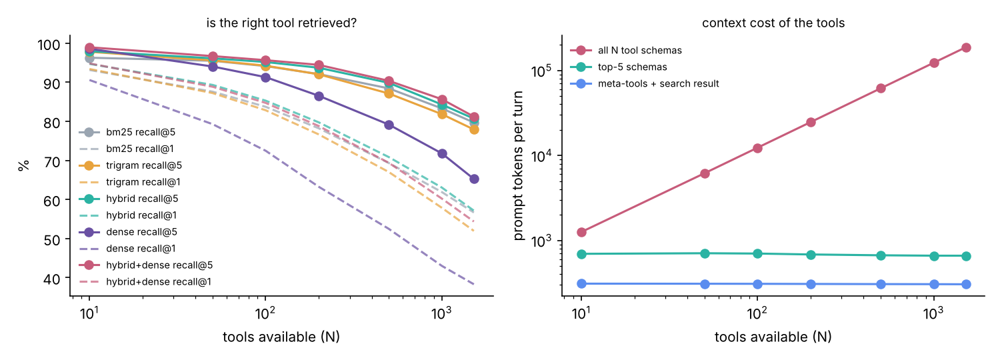

# ContextCache

Deciding which tools, Skills and memories enter an agent's context. Two parts:

- an **MCP gateway in Go** (protocol written from the spec, no SDK) that aggregates many MCP servers and, instead of listing every tool, exposes `search_tools`, `load_tool` and `call_tool` plus a per-session set of loaded tools kept under a token budget by a W-TinyLFU admission cache, with per-tenant authorisation and per-call tracing;
- **MemRevise**, a benchmark for agent memory under revisions, corrections and deletions, with a bi-temporal store (Postgres and in-memory) and six baselines.

## Results (measured on one 2-vCPU VM; no model was called anywhere)

Full tables: [`results/SUMMARY.md`](results/SUMMARY.md). Design: [`docs/DESIGN.md`](docs/DESIGN.md).

**Tool overload** (Berkeley Function Calling Leaderboard: 1,520 tools, 1,911 queries with one correct tool; the correct tool plus N-1 random distractors). Right tool in the top 5, by ranker:

| tools available | BM25 | trigram | hybrid (BM25 + trigram) | dense (GloVe SIF) | hybrid + dense | prompt tokens, all tools listed | tokens, meta-tools + search result |
|---|---|---|---|---|---|---|---|
| 100 | 94.1% | 94.2% | 95.2% | 91.3% | 95.7% | 12,353 | 309 |
| 500 | 88.4% | 87.1% | 89.8% | 79.2% | 90.4% | 61,688 | 307 |
| 1,520 (whole catalog) | 79.7% | 77.9% | **80.7%** | 65.3% | 81.2% | 187,421 | **305** |



- Listing all 1,520 tools costs 187k tokens per turn, more than most context windows. Searching costs about 305 tokens (meta-tool definitions plus five names and one-line descriptions) and loading the chosen schema about 120 more: **99.8% fewer tool tokens per turn**. The hybrid ranker puts the right tool first for 85.3% of queries at 100 tools and 57.1% at 1,520 (87.2% in its top 10).
- **Dense retrieval was worse than BM25, not better.** With static word vectors (100-d GloVe, SIF weighting, first principal component removed), recall@5 at 1,520 tools is 65.3% against 79.7% for BM25, and the gap widens with N (3 points at 100 tools, 14 at 1,520). Fused with BM25 and trigrams it is about even with the plain hybrid: 81.2% vs 80.7% recall@5, 89.0% vs 87.2% recall@10, and worse at top 1 (54.4% vs 57.1%). BFCL queries usually share exact terms with the right tool's name and description, which BM25 rewards and an averaged word vector blurs. A static embedding is not a modern sentence encoder, so this says nothing about dense retrieval with one.
- **pgvector**: the same vectors in Postgres 16 with pgvector 0.6 and an HNSW index (m = 16, ef_construction = 64, built in 0.38 s): the approximate top 10 shares 99.2% of its entries with exact cosine search, recall@5 65.0% (exact 65.3%), query p50 0.61 ms / p99 1.80 ms. At 1,520 vectors an in-process brute-force scan is faster (0.48 ms p50); the index matters at catalog sizes this benchmark does not have.

**Skill triggering** (each tool plays an Agent Skill; BFCL irrelevance queries should trigger nothing; threshold tuned at 100 skills and held fixed): precision/recall 89/84% at 10 skills, 76/66% at 100, 52/52% at 500 and 38/44% at 1,520, with false triggers on irrelevant requests rising from 14% to 68%, while the always-loaded tier-1 descriptions grow to 34.5k tokens. Description-based triggering does not scale past a few hundred skills without something better than lexical matching.

**Session cache** (30,000 turns, Zipf tool popularity with trend shifts, real BFCL queries): with a 1,000-token tool budget, retrieval alone put the needed tool in context 92.6% of the time against 18% (LRU), 30% (LFU) and 30% (W-TinyLFU) for a cache alone. Retrieval does almost all the work. Giving half the budget to a cache helps only at the largest budget (97.6% vs 96.9% at 8,000 tokens) and costs hits at tight ones (89.2% vs 92.6% at 1,000). Within that split W-TinyLFU beats LRU (89.2% vs 85.7% at 1,000); as a cache on its own, plain LFU beats W-TinyLFU at every budget.

**Gateway overhead** (stdio, 10 upstream servers): +0.22 ms p50 / +0.40 ms p99 per `tools/call` for one caller, +0.42 / +1.23 ms with 8 concurrent callers; `search_tools` over 1,520 tools p50 3.0 ms, p99 11.7 ms.

**Conformance**: the official MCP Python SDK 2.3.0 as the client passes 16 of 16 checks over stdio (meta and all modes, pagination over 1,520 tools, list-changed capability) and Streamable HTTP (two tenants isolated by bearer token, bad token rejected).

**MemRevise** (20 users x 3,000 events over a year; 2,000 queries; about 86k tokens of history per user):

| store | overall | current | deleted | as of a past date | as recorded at a past date |
|---|---|---|---|---|---|
| **bi-temporal (Postgres and in-memory)** | **100%** | 100% | 100% | 100% | 100% |
| timestamped log (record time used as valid time) | 86.0% | 100% | 100% | 65.8% | 100% |
| key-value, latest value only | 49.5% | 100% | 100% | 24.1% | 22.9% |
| dense similarity (GloVe SIF), most recent of top 5 | 22.4% | 20.6% | 19.3% | 26.0% | 19.0% |
| dense similarity (GloVe SIF), top 1 | 19.8% | 17.2% | 19.3% | 23.8% | 16.4% |
| BM25 similarity, top 1 (vector-memory style, no temporal fields) | 18.1% | 1.3% | 96.4% | 24.3% | 15.0% |
| BM25 similarity, most recent of top 5 | 17.7% | 7.4% | 83.1% | 18.7% | 17.4% |

Dense vectors find the fact more often than BM25 (17-21% of current values vs 1-7%) and then bring deleted facts back: after a delete, the old statement of the value is still the nearest neighbour, so only 19% of deleted-fact queries come back empty. BM25's high score on deleted facts mostly reflects how rarely it retrieves a fact at all. Neither similarity memory can answer time-scoped questions.

Postgres store: write p50 1.27 ms / p99 2.73 ms (one transaction per fact change, 26,904 writes), read p50 0.34 ms / p99 0.66 ms.

## A data problem the benchmark caught

The first catalog had 2,681 tools, but BFCL repeats many APIs across questions with small wording or schema changes (47 variants of `get_current_weather`): 1,566 tools shared a name with another, and 72% of queries had same-name twins. Retrieving the "wrong" `get_current_weather` counted as a miss, which no real deployment would have. The catalog now keeps one tool per name (first definition), and every number above uses it.

## What is here

```
mcp/        MCP from the spec: JSON-RPC 2.0, initialize/version negotiation, tools/list with cursors, tools/call,
            list_changed, stdio and Streamable HTTP (JSON mode, sessions, bearer-token tenants); client for upstreams
gateway/    aggregation, namespacing, meta-tools, per-session W-TinyLFU loaded set, tenant filtering, tracing
retrieve/   BM25, character-trigram TF-IDF, dense (GloVe + SIF), reciprocal rank fusion, pgvector store
admit/      token-budgeted LRU, LFU and W-TinyLFU (count-min sketch, doorkeeper, window, aging)
catalog/    BFCL loader (tools, queries, irrelevance queries), JSON Schema fix-ups
tokens/     cl100k token counting (offline tiktoken)
memory/     MemRevise generator, independent reference replay, bi-temporal store (memory + Postgres), baselines, scorer
cmd/        ccgw (gateway), toolfarm (upstream MCP server), ccbench (overload, pgvector, skills, cache, latency), memrevise
bench/      prepare.sh (fetch BFCL), run_all.sh, conformance.py (official SDK), plot.py
```

## Reproduce

```
bench/prepare.sh        # once: sparse checkout of BFCL data, builds data/catalog.json
pip install mcp         # for the conformance check
bench/run_all.sh        # about 16 minutes; needs Postgres with pgvector (DSN in the script); fetches
                        # GloVe 100-d (glove-wiki-gigaword-100 release of RaRe-Technologies/gensim-data)
go test ./...
```

The MemRevise dataset is regenerated deterministically (`data/memrevise/events.jsonl`, `queries.jsonl`, seed 2026).

## What is not here

- **LLM tool-selection accuracy**: needs a model; none was available in the build environment. Recall@k is an upper bound on selection accuracy for an agent that sees only the top k. RAG-MCP's 13.62% vs 43.13% is their measurement, not reproduced here.
- **A neural embedding model**: none could be downloaded. Dense retrieval uses static GloVe vectors with SIF weighting (a 2017 baseline), behind the same `Ranker` interface and pgvector store a modern encoder would use. "Dense lost to BM25" is a result about static word vectors only.
- **CloudWeGo Eino**: the gateway is plain Go with its own MCP implementation; it is not built on Eino and nothing was contributed to Eino or eino-ext.
- **Skills**: triggering is measured with tools playing skills (name + description as tier 1), not with a corpus of real SKILL.md files, and the trigger is a retrieval threshold, not a model's decision.
- **Protocol**: the gateway speaks MCP up to 2025-11-25 and negotiates that version with SDK 2.3.0 (whose newest is 2026-07-28); Streamable HTTP is served in JSON-response mode only (no SSE stream, so list_changed is delivered over stdio only).
- MemRevise stores receive structured events; extraction from free text and reading answers out of retrieved memories (where LLMs make mistakes) are deliberately outside the benchmark.

## Resume bullets (numbers from `results/`)

- Built ContextCache, a Go MCP gateway (protocol implemented from the spec) that aggregates MCP servers behind search, load and call meta-tools with a token-budgeted W-TinyLFU loaded-tool set, per-tenant auth and per-call tracing; passes 16/16 conformance checks against the official MCP Python SDK.
- On the 1,520-tool BFCL catalog, hybrid BM25 + trigram retrieval put the right tool in the top 5 for 80.7% of queries (95.2% at 100 tools) while cutting tool tokens per turn by 99.8% (187k to about 430), at +0.22 ms p50 / +0.40 ms p99 gateway overhead per call; static-embedding dense retrieval served from pgvector HNSW (0.61 ms p50) scored lower than BM25 (65.3% vs 79.7%) and added under a point in fusion.
- Designed MemRevise, a revision-aware agent-memory benchmark (current, deleted, as-of and as-recorded queries with exact ground truth), where a bi-temporal Postgres store scored 100% against 49.5% for latest-value memory and 18-22% for BM25 and dense similarity memory, at 2.7 ms p99 writes.

## Interview defence

See `docs/DESIGN.md` section 7 (why bi-temporal, keeping deleted facts deleted, why W-TinyLFU over LRU, how MemRevise differs from LoCoMo and LongMemEval). Be ready to say plainly that in the session benchmark retrieval did most of the work, that LFU beat W-TinyLFU as a cache on its own, and that the dense retriever lost to BM25 (and why that does not generalise to modern encoders).
